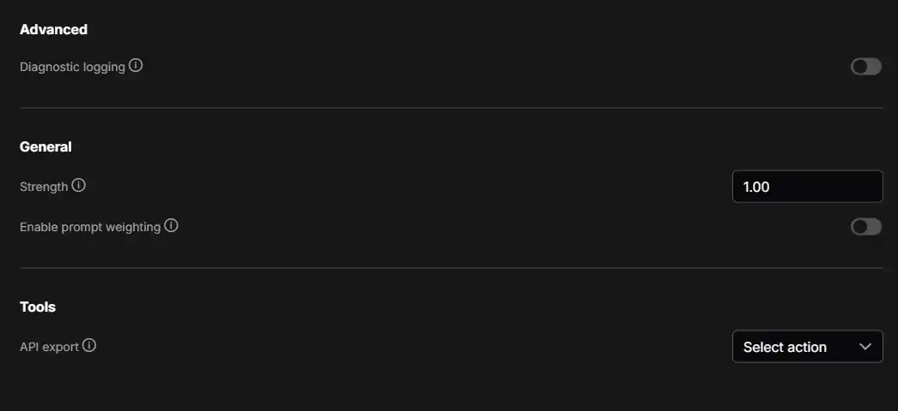

# ComfyUI-MOSS-Emphasis v0.10.0

[English](README.md) · [検証結果](docs/VALIDATION.md) · [参照元](NOTICE.md)

**Settings → MOSS Emphasis**で、通常の重み付けと**NegPiP**を切り替える拡張です。普通の**CLIP Text Encode**を使い、専用ノードをキャンバスへ置く必要はありません。

**v0.10.0はNegPiPを搭載**し、**標準MOSS-Image、SDXL／Illustrious、標準Animaの3系統**に対応します。自動判定モードでは、**それ以外のモデルは本拡張を自動で無効化（バイパス）**し、標準処理で生成を続けます。Qwen-Image・FLUX・SD1.5・SD3・Krea2・SDXL Refinerなども対象です。CPU検証段階の試験版で、新アダプターのGPU画質・速度・VRAMは未検証です。[リリースノート](docs/RELEASE_NOTES_0.10.0.md)。

## インストール・更新

ComfyUIの `custom_nodes` 内で実行します。

```sh
git clone https://github.com/ukr8b3g-cmyk/ComfyUI-MOSS-Emphasis.git
```

既存導入先は更新後、**ComfyUI本体を再起動してからブラウザーを再読み込み**してください。画面更新だけではPython側は更新されません。追加pip依存・PPM／KJNodesの導入・モデルのダウンロードは不要です。対象モデルの標準対応とV3ノードAPIを備えるComfyUIが必要です。検証版は[検証結果](docs/VALIDATION.md)に記載しています。

## 使い方と切り替え

通常のMODEL・Positive・Negativeの配線を維持し、設定 → MOSS Emphasisを開きます。

| 設定 | 意味 |
|---|---|
| プロンプトの重み付けを有効化 | 全体のON/OFF。ワークフロー単位で保存。新規はOFF |
| 重み付け強度 | 通常方式専用。0～4、開始値は1 |
| NegPiP方式を使用 | OFFで通常方式、ONでモデル別NegPiP。重ね掛けはしない |
| NegPiP効果 | NegPiP専用。0～1、開始値は1 |
| 現在の方式 | 方式・強さと「モデル自動判定」または「旧MOSS方式」を表示 |

**MODELとCLIPの実際の型から自動判定**します。モデル名での判定や手動モデル選択はありません。全体OFFの間はNegPiPだけONにしても無効です。使っていない方式の強さは保存されますが、計算には使いません。

使用中の強さが**0**、または全体OFFなら本拡張を完全にバイパスします。ただし、**SDXL／Animaが標準で持つプロンプト重みは原文に対して働きます**。「本拡張OFF＝モデル標準の重みまで無効」ではありません。



*画像はNegPiP追加前です。現在は「有効化 → 強度 → NegPiP → NegPiP効果 → 現在の方式」の順です。ComfyUIが日本語ならラベル・マウスオーバーヘルプも日本語になります。保存する設定IDは同じです。*

## モデル別の処理

| モデル | 通常方式 | NegPiP効果1 | 確認範囲 |
|---|---|---|---|
| 標準MOSS-Image Base／SFT | 既存KJ式のValue倍率・Attention bias | PPM参照のlog絶対値bias・Value符号 | 従来の計算を維持、CPU回帰確認 |
| 標準SDXL Base系／Illustrious系 | 標準CLIP-L／Gの重み | 絶対値重み＋Key／Value分離、負の語のValue反転 | 実tokenizer・encoder処理・batch・小さな実AttentionのCPU確認 |
| 標準Anima | Qwenアダプター後のT5トークン重み | T5重みの絶対値＋負の語のValue反転 | 前処理／forward・padding・batch・小さな実AttentionのCPU確認 |
| Qwen-Image・FLUX・SD1.5・SD3・Krea2・SDXL Refinerなど、上記以外すべて | 自動でバイパス | 自動でバイパス | モデル標準の処理で生成を続行 |

自動判定モードでは、未対応モデルの重み付け・Attention変更をスキップし、原文・MODEL・Negativeを標準処理へ渡します。保存済みのON/OFFや方式は書き換えず、対応モデルへ戻すと選択中の方式が再び働きます。スキップはサーバーログに記録します。対応MODELとCLIPの不一致は引き続きエラーです。実行グラフ・Conditioningの対応範囲チェックは残るため、一体型サンプラーなどの未対応配線まで自動対応するものではありません。

ここでのQwen-Imageは画像生成モデルのことです。MOSSやAnimaが文章エンコーダーにQwenを使うこととは別で、エンコーダー名だけで無効にはしません。

Illustriousは標準SDXLの構造として扱います。検証ではIllustrious／Animaのチェックポイント自体はロードしていません。Animaは既存のT5 **tokenizer由来の情報**を使い、T5エンコーダーモデルを追加ロードしません。MODELとCLIPは同じモデル向けの標準ペアを使ってください。

対象は**Positive内の重み**です。Negativeは、元々ある標準の重みも含めて計算上の意味を保ちます。SDXL NegPiPではKey／Value分離に合わせてNegativeを内部で同一内容の2本へ変換しますが、Negative文をNegPiPで再解釈しません。

## 重み・0・1の意味

```text
1girl, (red hair:1.2), (realistic:-5)
```

負の数字を書いただけではNegPiPに切り替わりません。選択中の方式で負の重みとして扱います。プロンプト重みに固定の上下限はありませんが、非有限数・係数のoverflow・使用dtypeで表現できない値はエラーになります。絶対値を増やしても画像上の抑制が比例するとは限りません。

| 通常強度／NegPiP効果が1のとき | 重み0 | 重み1 |
|---|---|---|
| MOSS通常 | Value倍率0。Keyは残る | 通常の重み |
| MOSS NegPiP | bias用の絶対値を1e-4へfloor。Value符号は正 | 相対重み1。他トークンとの正規化の影響あり |
| SDXL通常／NegPiP | 空プロンプト基準の埋め込み。NegPiPでも符号は正 | 標準の埋め込み |
| Anima通常／NegPiP | 対応する変換後contextを0倍。NegPiPでも符号は正 | 標準の重み |

どれも「概念が必ず消える」という意味ではありません。`(realistic:1)` は通常重みであり、写実化を特別に強める指定ではありません。

**構文はモデルで異なります。** MOSSは既存の明示小数構文・普通の括弧の文字扱い・入れ子の積・128グループ／16階層制限・文字位置対応を維持します。Layout JSONでは `summary.caption` と `items[].caption` だけを処理します。SDXL／Animaは**標準tokenizer**の括弧・エスケープ・入れ子・トークン重みを使い、MOSS用JSON保護は適用しません。A1111／Compelの正規化モードでもありません。

SDXL／Animaの通常強度`s`は、重み`w`を `1+s*(w-1)` に変換します。NegPiP効果`t`では絶対値重みを `1+t*(abs(w)-1)`、負の語のValue倍率を `1-2*t` とします。効果**1**が固定PPM参照との比較基準で、中間効果は本拡張独自の機能です。**0.5**では負の語のValueが0になりますがトークンは残ります。MOSSでは従来のlog-bias補間です。

## 対応配線・旧設定

通常の `CLIPTextEncode → KSampler / KSamplerAdvanced`、または `CLIPTextEncode → CFGGuider → SamplerCustomAdvanced` に対応します。Text Multiline／CSV／文字列連結から `CLIPTextEncode.text` へ入力できます。通常のLoRA・CLIP skipは標準エンコーダー経路を利用します。

初期対応範囲には `CLIPTextEncodeSDXL`、Advanced CLIP、領域／時間指定／結合Conditioning、ControlNet／IPAdapter、Refiner、独自HFローダー、一体型カスタムサンプラーを含みません。同じ経路の別の重み・attn2置換は二重適用を拒否します。未対応のワークフローではOFFにしてください。

MOSSの制限は従来どおりで、PyTorch/basic、標準の全体Comfy Kitchen INT8 (`--use-ck-attention`) 経路と公式SLGが対象です。Sage／Flash／SOL上書き・層ごとの設定済みINT8は対象外です。実GPUのKitchen／SLG動作は未検証です。SDXL／Animaは標準Attention hookを使い、選択済みカーネルを置き換えません。CPU合格は全GPUバックエンドの保証ではありません。

**schema 1/2の保存済みワークフローは旧MOSS専用動作を維持**します。開いただけでは他モデルの重みを突然有効にしません。新対応を使うには重み設定を明示的に操作（例：全体OFF→ON）して保存してください。状態表示が「旧MOSS方式」から「モデル自動判定」に変わります。診断ログだけでは移行しません。方式やタブを切り替えても両方の強さを保持します。

画面の配線は変更せず、実行グラフのコピーへ内部runtimeを挿入します。設定はジョブごとに固定されキャッシュへ反映されます。グローバルなtokenizer／Attention関数、CFG・サンプラー・スケジューラー・モデルファイル・ComfyUI本体は変更しません。

## API・検証

設定 → MOSS Emphasis → APIエクスポート → **実行用API JSONを書き出す**を使ってください。`/moss_emphasis/prepare` の例は[英語README](README.md#api-and-tests)にあります。prepareの外側形式はversion 1、設定はschema 3です。準備エラー時に重みなし生成を投入しません。通常のComfyUI API保存だけでは変換が含まれない場合があります。

```sh
python -m unittest discover -s tests -v
node --test tests/frontend.test.mjs tests/locales.test.mjs
python -B tests/native_contract.py --comfy-root /path/to/ComfyUI
```

[検証結果](docs/VALIDATION.md)では単体テスト・実CPUモジュール・未実施のGPU／画面確認を分けています。GPL-3.0-only。[NOTICE](NOTICE.md)にPPM／KJ／本体の参照元を記載しています。同一画像の完全再現は保証しません。
